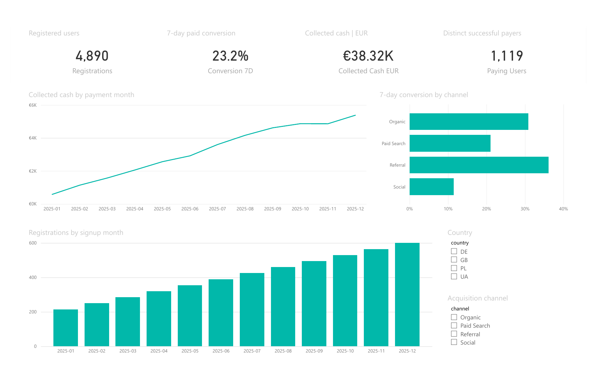
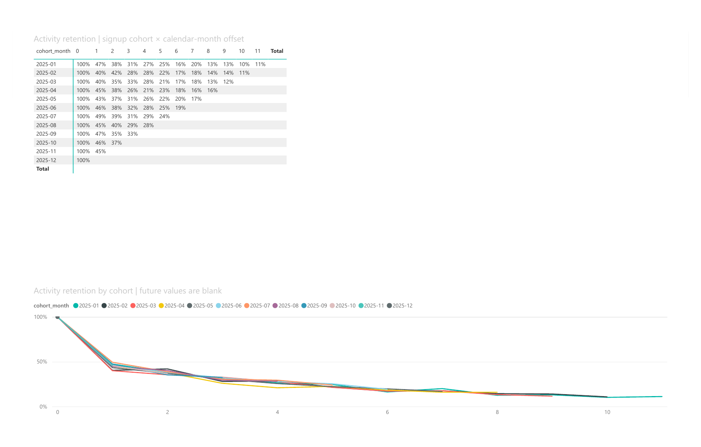
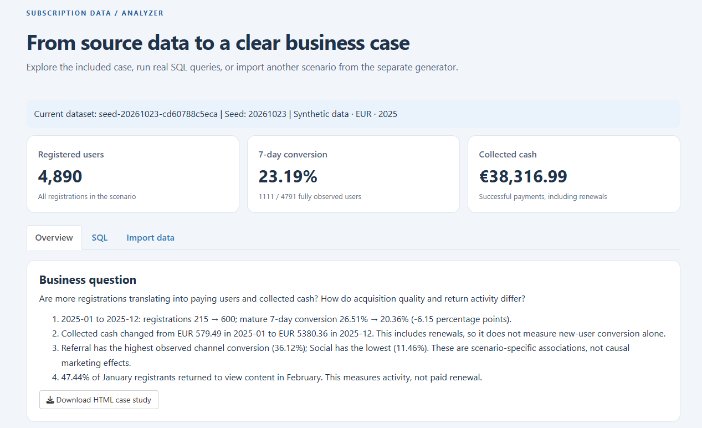
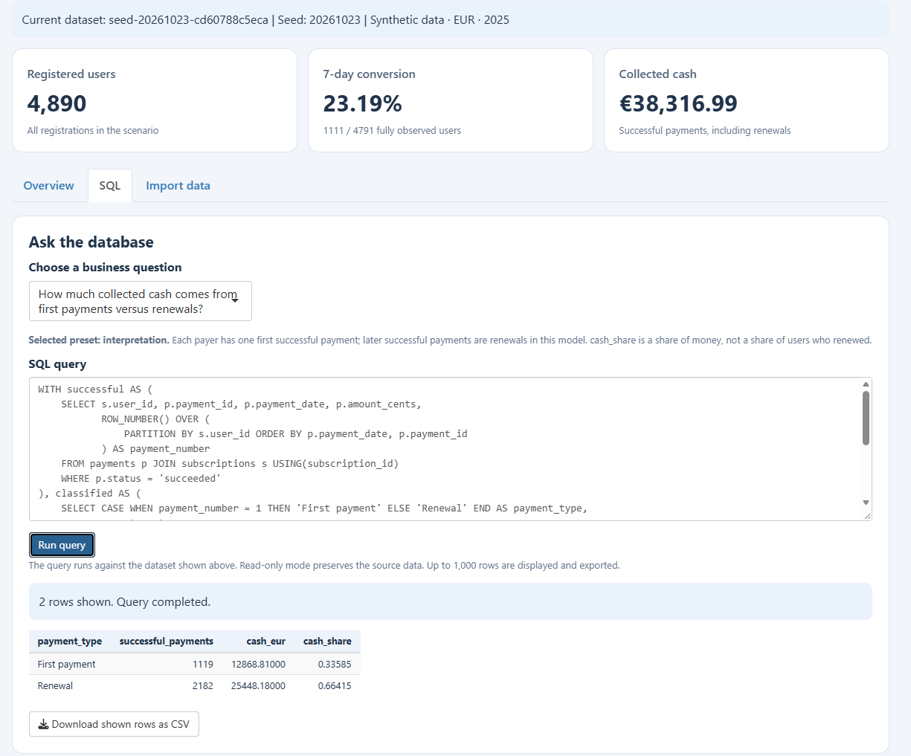
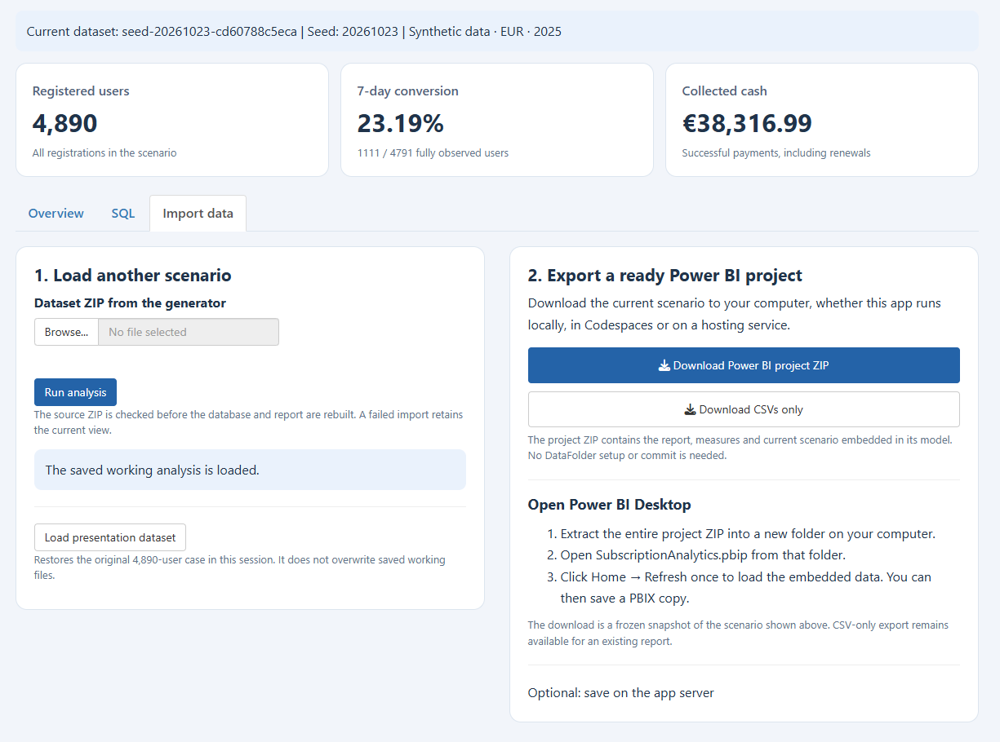
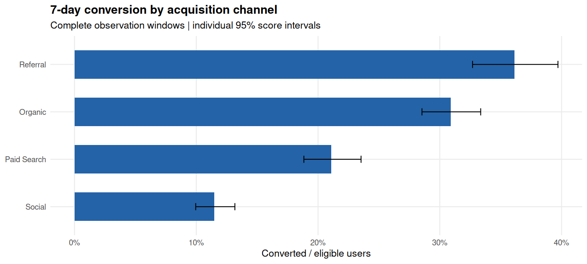
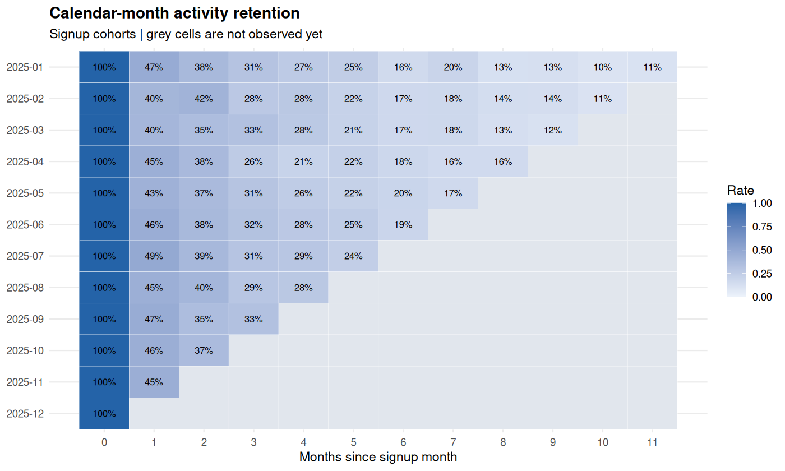
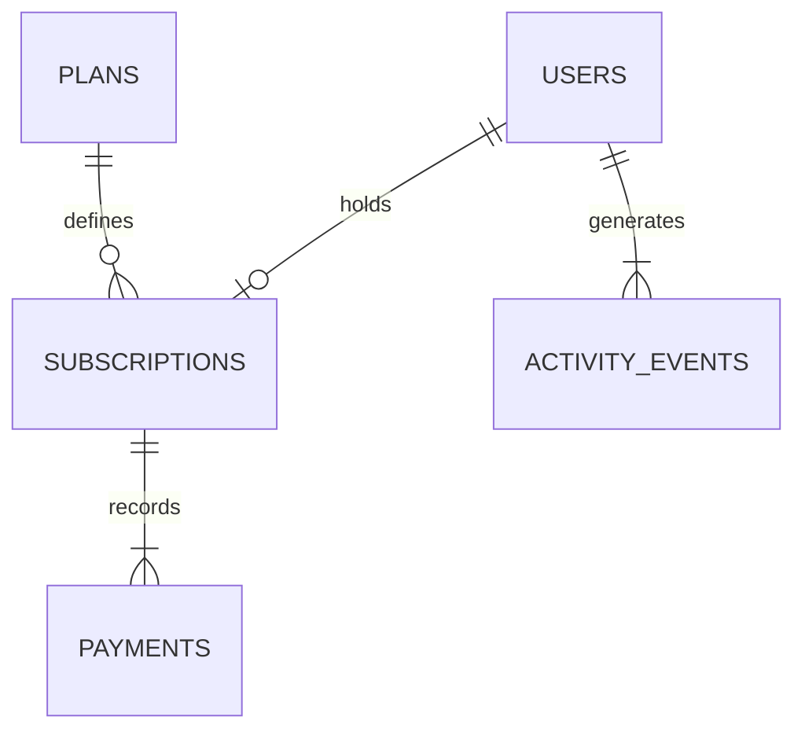

# Subscription Analytics: Growth, Conversion & Retention

**Registrations grew, conversion weakened, and cash increased. What do these measures actually tell us?**

A reproducible portfolio case study using **SQL, R and Power BI Desktop**, with a Shiny interface for importing scenarios, checking the evidence and exporting a ready-to-open Power BI project. All data is synthetic.

## Start with the results

- [Read the full findings and interpretation](results/findings.md).
- Open `results/report.html` in a browser for the self-contained case study, charts and saved results of all 12 SQL questions.
- [Download the presentation Power BI project](powerbi/PowerBI-Presentation.zip?raw=true), extract the entire ZIP, open `SubscriptionAnalytics.pbip` and click **Home → Refresh** once. Its scenario is embedded; no local data-path setup is required.
- Inspect [the twelve SQL questions](sql/03_questions.sql) and [the Desktop/export guide](POWER_BI.md).

The normal GitHub file view shows HTML source. Download the HTML to view it locally. The web analyzer runs through R or Docker; this repository does not claim a published online service.

## Project preview

### Power BI: acquisition, conversion and cash



The original presentation case: **4,890 registrations, 23.2% mature seven-day conversion and EUR 38.32K collected cash**. The 1,119 successful payers include users without full seven-day follow-up; this is a different count from the 1,111 mature conversions. Figures on this page are rounded for display.

### Power BI: calendar-month activity retention



M0 is 100% by construction. Later columns show content-view activity among the original signup cohort; blank future periods are unobserved. This measures activity retention, not paid subscription renewal.

These two previews are rendered from the Power BI PDF export. [View the complete two-page Power BI report](media/subscription-analytics-report.pdf). The PDF is a static preview; use the PBIP project for interactive filtering.

### Shiny: the analytical workspace



The analyzer connects the current dataset to its KPIs, SQL workspace and interpretation. All analyzer previews above and below show the original 4,890-user presentation case.

<details>
<summary>View live SQL and the import/export workflow</summary>

**Read-only SQL workspace.** The example separates first-payment cash from renewal cash and displays the query result.



**Scenario import and portable Power BI export.** Import another dataset, inspect its analysis, then download a Power BI project containing that scenario.



</details>

## Business question and scope

The fictional service offers Basic and Premium content subscriptions. Users register through four acquisition channels, may start paying, may renew, and may return to view content.

The analysis separates three questions: **how many users arrive, how many new users convert, and how much cash is collected from the whole audience**. It also examines return-to-content activity by signup cohort.

The included presentation dataset covers **2025-01-01 through 2025-12-31**, uses EUR and contains **4,890 registrations**. Source dates have day precision. There are no advertising costs, refunds, discounts, taxes, annual plans or plan changes; profitability and acquisition ROI are outside the evidence.

## Executive results — original presentation case

| Measure | Evidence | Interpretation |
| --- | --- | --- |
| Registrations | January 215 → December 600 | Acquisition volume increased; this does not establish that user quality improved |
| Mature 7-day conversion | 26.51% → 20.36%, a decrease of 6.15 percentage points | A smaller share of sufficiently observed new users made a first payment in the defined window |
| Overall 7-day conversion | 1,111 / 4,791 = 23.19% | The denominator excludes users whose full observation window is unavailable |
| Collected cash | EUR 38,316.99; monthly cash EUR 579.49 → EUR 5,380.36 | Successful payments include renewals, so cash and new-user conversion measure different processes |
| First-payment cash | EUR 12,868.81, or 33.59% of cash | Money collected from each payer's first successful payment |
| Renewal cash | EUR 25,448.18, or 66.41% of cash | Most cash came from subsequent successful payments; this is not a 66.41% renewal rate |
| Referral vs Social conversion | 259/717 = 36.12% vs 173/1,509 = 11.46% | A 24.66-point observational difference, not evidence of causal channel effectiveness |
| January M1 activity retention | 102/215 = 47.44% | Almost half of January registrants viewed content in February; paid renewal is a different metric |

### 1. Growth does not answer the conversion question

There were more December registrations, but the mature conversion rate was lower than January's. Counts and rates must be reviewed together. An aggregate rate can change when the channel/country mix changes, even without a uniform change within every subgroup.

**Next check:** compare channels within signup month and country, with eligible and converted counts alongside the percentages. The endpoint comparison is descriptive; no significance claim is attached to the monthly decline.

### 2. The cash result is not a contradiction

The service collects both first payments and subsequent payments from its accumulated audience. SQL question 12 separates these streams: **1,119 first successful payments** produced EUR 12,868.81, while **2,182 subsequent successful payments** produced EUR 25,448.18.

This explains why improving total cash does not automatically imply improving new-user conversion. The annual split provides context; it does not by itself attribute the entire January-to-December cash increase to renewals. A monthly first-payment/renewal decomposition is the next investigation.

The 1,119 first payments are not the 1,111 mature conversions. Cash includes payments from all observed payers; the conversion metric additionally requires a fully observed seven-date window. In this presentation dataset eight first-paying users have incomplete follow-up.

### 3. Channel differences are a lead for investigation

Referral has higher observed conversion than Social. This does not justify a budget transfer: the synthetic generator deliberately sets different channel probabilities, acquisition is not randomized, and spend is missing. Conversion alone cannot establish which channel produces better economics.

**Next check:** inspect country/month composition, then obtain costs and comparable follow-up. The plotted 95% score intervals describe individual conversion proportions; they are not a causal or multiple-comparison test.



### 4. Retention describes activity, not subscription survival

January M1 is 102 returning users out of the original 215 registrations. The denominator includes non-payers. One content-view date is enough to count as active, and someone can return after missing an earlier month.

Calendar-month cohorts have unequal first-month exposure: a January 31 signup and February 1 return count in M1 despite a one-day gap. **M0 is 100% by construction**, and grey future cells are unobserved, not zero.

**Next check:** compare cohorts at the same month offset. On real data, validate events and investigate comparable early engagement before proposing retention interventions.



## What the analysis can support

It supports reproducible descriptive conclusions about this dataset and shows how to define metrics, avoid double-counting, reconcile cash and inspect cohorts. The appropriate recommendation is a set of **next checks**, not an untested commercial rollout.

It does not demonstrate causal acquisition effects, incremental revenue, profit, MRR, paid churn or LTV. The figures and case-study HTML are generated by R; they are not Power BI screenshots.

## Run the analyzer

With Docker Desktop running, execute from the folder containing `compose.yaml`:

```sh
docker compose up --build
```

Open **http://localhost:3839**. Later starts use `docker compose up`; stop with Ctrl+C. The separate generator uses port 3838.

Without Docker, install R 4.3 or later and run:

```sh
Rscript setup.R
Rscript start.R
```

In RStudio, open `SubscriptionAnalyzer.Rproj`, run `source("setup.R")` once, then `source("start.R")`.

| View | Purpose |
| --- | --- |
| **Overview** | Current-scenario KPIs, findings, charts and structured interpretation |
| **SQL** | Twelve editable presets, read-only SQLite execution and CSV download |
| **Import data** | Validated ZIP import, presentation-case restore, Power BI exports and optional server-side save |

The included case is ready on first launch. Imported scenarios receive their own recalculated findings; the numbers in this root README remain the original presentation case.

## Import → analyze → download a complete Power BI project

1. Download a source ZIP from **Subscription Data Generator**.
2. In **Import data**, select that ZIP and click **Run analysis**.
3. Inspect Overview and SQL for the new scenario.
4. Click **Download Power BI project ZIP**.
5. Extract the complete archive locally, open `SubscriptionAnalytics.pbip`, then click **Home → Refresh** once.

The downloaded project contains the native report, all eight measures, the current scenario embedded in its Power Query model, readable CSV copies, dataset metadata and an HTML case study. It needs no `DataFolder`, repository commit or download of the full source repository. After the first refresh, Desktop can save a local PBIX copy.

The export is a frozen scenario: editing its readable CSV copies does not change the embedded model. Export a new package for a new scenario. A PBIP is a source project, not a pre-refreshed PBIX; initial Desktop refresh is required.

**Download CSVs only** remains available for an existing CSV-linked report. Extract those CSVs into the local folder that report reads, then refresh it.

## Optional: work in your own fork or branch

**Save on app server** replaces working `data/` and `results/` on the computer running R. With local Docker bind mounts these are local project files; in Codespaces they are files in the remote checkout. This action neither downloads files to your PC nor commits/pushes to GitHub.

For a scenario you want to keep in your own repository:

1. Create/use your own fork or working branch.
2. Import and analyze the source ZIP, then confirm **Save on app server**.
3. Review the changed files and updated findings.
4. Commit and push the intended changes manually.

The included `powerbi/SubscriptionAnalytics.pbip` remains a CSV-linked working template for this workflow; configure its `DataFolder` once. The separately downloaded portable package has no such path dependency.

`data/baseline.zip` and `powerbi/PowerBI-Presentation.zip` retain the original presentation case. **Load presentation dataset** restores it in the current session. Download its Power BI package or explicitly save it on the server as needed. On hosted services server files may be temporary; use downloads to retain a scenario.

The importer accepts flat v2.0 source ZIPs and original v1.0 source bundles. The preserved baseline comes from generator v1; the same seed in generator v2 does not reproduce v1 outcomes. Inputting the entire application ZIP or a Power BI export is not supported.

## Twelve SQL questions

| # | Analytical question | Main technique |
| --- | --- | --- |
| 1 | Which channels bring registrations? | GROUP BY, ORDER BY |
| 2 | Which plans collect cash? | JOIN, aggregation |
| 3 | Which users never paid? | LEFT JOIN-based view, NULL |
| 4 | What is fair 7-day conversion by channel? | Eligibility filter, ratios |
| 5 | Who collected more cash than the average user? | Subquery |
| 6 | What is each user's successful payment sequence? | ROW_NUMBER, LAG |
| 7 | How do channels rank by total cash? | CTE, RANK |
| 8 | How does monthly cash change? | Monthly view, LAG, zero-denominator handling |
| 9 | Which cohort periods are observed? | Cohort view, NULL semantics |
| 10 | What share of paying users paid more than once? | Conditional aggregation |
| 11 | How many attempts succeeded or failed? | Status grouping |
| 12 | How much cash comes from first payments versus renewals? | CTE, ROW_NUMBER, classification and shares |

Question 12 turns the payment sequence into a business explanation: the first successful payment is separated from subsequent payments, and each group is reconciled to total cash.

The editor displays/exports at most 1,000 rows per run; the saved HTML shows up to 10 rows per preset. Neither limit deletes data from SQLite.

## Source map and reproducibility

```text
subscription-analyzer/
  app.R                 browser interface
  import_data.R         ZIP, schema and hash validation
  analysis.R            database, analysis, interpretation and exports
  setup.R / start.R     install and launch
  data/                 source, SQLite, processed CSVs, baseline ZIP
  sql/                  schema, metric views and business questions
  powerbi/              working template and original portable report
  results/              current HTML report, figures and evidence
  media/                Shiny previews and static Power BI report
```



The source model is relational. Power BI has a Users-to-Payments relationship and a disconnected pre-aggregated Cohorts table. Overview country/channel slicers do not recalculate cohort retention on the separate Retention page.

Optional command-line rebuild:

```sh
Rscript import_data.R path/to/source-dataset.zip --replace
Rscript analysis.R
Rscript check.R
```

Import already runs the analysis; `analysis.R` independently rebuilds saved working inputs when needed. CLI commands operate on the machine running R, not automatically on the browser visitor's PC.

## Verification

Executed checks cover source hashes and schema, hand-calculated metric boundaries, all 12 queries, read-only SQL, seed reproducibility, import failure recovery, server-side interface actions, HTML generation and Power BI export structure/data consistency. Run `Rscript check.R` after setup to repeat the data and SQL checks. The project preview includes Shiny screenshots and pages exported from Power BI Desktop for the original presentation case.

[Power BI/export details](POWER_BI.md)

